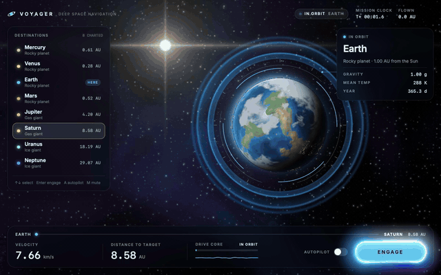

<h1 align="center">Voyager</h1>

<p align="center">
  Fly the solar system at warp speed.<br>
  A space travel demo built with <a href="https://github.com/anomalyco/rune">Rune</a>, a GPU-rendered UI framework for Rust.
</p>

<p align="center">
  
  <a href="https://github.com/anomalyco/rune"></a>
  
  <a href="LICENSE"></a>
</p>

<p align="center">
  
</p>

Pick a planet and press Engage. The drive spools up, a shockwave ripples through the whole window, the stars stretch into a tunnel, and you drop out in orbit around the next planet.

All eight planets are there. Mercury has craters, Earth has city lights on its night side, Jupiter has its red spot, Saturn and Uranus have rings, and Neptune has a dark storm.

Nothing on screen is a picture or a video. One shader draws space, Rune draws the interface, and the sounds are sines and noise put together by a small program in this repo.

## Run it

```sh
git clone https://github.com/trondegil/voyager-deep-space-navigation
cd voyager-deep-space-navigation
cargo run --release
```

The first build compiles Rune and wgpu, which takes a minute or two. `rust-toolchain.toml` pins Rust 1.99.1, the version Rune builds with, and rustup installs it if it is missing.

| Input | What it does |
| --- | --- |
| Click a planet, Up, Down, or 1 to 8 | Picks the destination |
| The Engage button, Return or Space | Starts the jump |
| The Autopilot switch, or A | Flies to the next planet every few seconds |
| M | Mutes and unmutes the sound |

A trip takes 8.6 seconds whatever the distance. The drive spools for 1.6, the tunnel lasts 4.6, and the approach takes 2.4. A longer trip goes faster. Earth to Neptune peaks at about 4,700 times the speed of light.

On macOS, `scripts/bundle-macos.sh` wraps the build as `target/Voyager.app` so Finder and the Dock show its icon. A plain `cargo run` shows the same icon in the Dock while it runs.

## Requirements

So far the demo has run on one machine, an Apple M4 laptop. The minimum column is what the software asks for. Nobody has measured how slow a machine can be and still keep up.

| | Minimum | Measured on the M4 |
| --- | --- | --- |
| Graphics | Any GPU that supports Metal, Vulkan or Direct3D 12. Integrated graphics is enough. | 60 fps at 2400×1500 pixels on the built-in GPU |
| Memory | About 250 MB free | 252 MB at its peak |
| Disk | 31 MB for the app, about 1.5 GB to build it | |
| System | The build targets macOS 11 and later. Windows and Linux are set up the way Rune's own examples are but untested. | macOS 27.2 |
| Window | 1080×680 points or larger | 1200×750 |
| Sound | Optional. Rune plays audio on macOS and Windows, so Linux runs silent. | |

Nearly all the work is on the GPU, and it grows with the size of the window, because one shader paints every pixel each frame. If it stutters, make the window smaller. The processor does about a millisecond of work per frame.

## How it works

Rune lays out and draws the interface. The picture behind it and the effects on top come from a compositor that paints into empty `effect` slots in the element tree.

- `src/space.wgsl` is one fragment shader for the whole scene. It draws the nebula and stars, the Sun, the planet you are orbiting, and the warp tunnel. A planet is either rocky, with seas, clouds, ice caps and craters, or banded, with cloud belts, a storm and rings that cast shadows.
- `src/gfx.rs` is the compositor. It runs that shader in the background slot and turns the other slots into `rune-fx` layers. Those are the glow and lightning on the Engage button, the radar rings around the planet, the sparkles on arrival, and the shockwave at each jump.
- `src/hud.rs` is the view. The panels are frosted with `backdrop_blur`, the reticle and oscilloscope are vector `canvas` shapes, and the list highlight and autopilot switch move on Rune's springs.
- `src/voyage.rs` holds the trip as a state machine. Every number the view and the shader show is a function of that state and the clock.
- `src/worlds.rs` is the table of planets.
- `src/sound.rs` plays five clips through Rune's `Player`.

## Sound

The whole trip is one 11-second clip, so the spool, the jump, the tunnel, the drop-out and the arrival chime stay in step with the picture. A quiet room tone loops while you are in orbit, and the list and the switch click.

`examples/make_sounds.rs` synthesizes all of it. There are no samples. `M` mutes, and `VOYAGER_MUTE=1 cargo run --release` starts muted.

## Headless runs

Rune apps can render without a window, on a fixed virtual clock. That is how the GIF and the icon were made.

```sh
B=target/release/voyager
$B --list-scenes
$B --scene jump --snap warp.png --at 4        # a still from the middle of the tunnel
$B --scene jupiter --snap jupiter.png --at 1
$B --script scripts/tour.json --video out/voyager.mp4 --size 1200x750 --scale 1 --pointer --keys bottom
cargo test
```

`--video` needs `ffmpeg` on your `PATH`. The tests click through the real view on a headless runtime.

Three scripts rebuild the generated files. All of them need `ffmpeg`.

| Script | Rebuilds |
| --- | --- |
| `scripts/make-sounds.sh` | The clips in `assets/sounds` |
| `scripts/make-icon.sh` | `assets/icon.png` and `assets/Voyager.icns`, drawn by the app's `icon` scene |
| `scripts/make-gif.sh` | `docs/voyager.gif`, from `scripts/tour.json` |

## Notes

Rune is pre-release. `Cargo.toml` pins one `dev` revision for Rune and for the five crates it patches, so update them together.

The planets' figures are the textbook ones, rounded. Their surfaces come from noise, not from maps, and their sizes on screen are not to scale. Distances assume the planets line up on the same side of the Sun, which they rarely do.

## License

[MIT](LICENSE)
